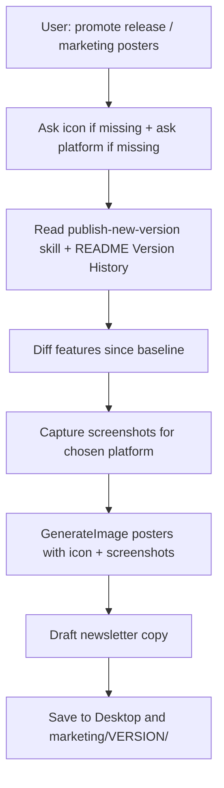

# Promote app release

## Goal

After a version is already published (or while marketing an existing current version), produce a **promotional pack**: real device screenshots, feature highlight board, mockup posters, newsletter banner + copy. Save under **Desktop** and **`marketing/<VERSION>/`**.

**This skill does not bump versions.** Changelog and semver come from `publish-new-version` / README. Do not run a version bump unless the user also asks for `/publish-new-version`.

## Triggers

Apply when the user says any of:

- promote release / promote app release
- marketing posters / promo images
- release newsletter
- App Store / Play Store promo images
- “make posters for vX.Y.Z”

## Preconditions — ask before generating

**Stop and confirm these inputs before screenshots or `GenerateImage`.** Do not assume StockApp / iOS defaults when the current project or chat has not already defined them.

### 1) Target version + baseline

1. Confirm **target version** (default: README `### vX.Y.Z (Current)`).
2. Confirm **baseline** for “what’s new” copy (default order):
   - User-stated baseline version, else
   - Previous `marketing/<version>/` folder if present, else
   - Last **3 patch** versions of user-facing notes from Version History

### 2) Brand / app icon (required)

Ask for a **brand icon or app icon** unless one is already clearly defined in this conversation or the project (e.g. user attached an image, or a known path such as `marketing/<VERSION>/app-icon.png` / asset catalog was already agreed).

When asking, accept any of:

- An attached image in chat
- An absolute or repo-relative file path
- A short instruction to reuse the last icon from this chat / `marketing/<VERSION>/app-icon.png`

Copy the chosen icon to `marketing/<VERSION>/app-icon.png` and pass it via `reference_image_paths` on every marketing image.

**Do not invent or substitute a different logo** (e.g. leaf icons) when the dual-H / project icon is available or the user supplied one.

### 3) Platform (required)

Ask which platform this promo pack is for unless already stated in the trigger (e.g. “Play Store only”, “iOS App Store”, “web release”):

| Choice | Use for |
|--------|---------|
| **Android** | Google Play — Android phone frames, punch-hole / flat bezel (not iPhone notch / Dynamic Island), CTA **“GET IT ON Google Play”** / **“Update on Google Play”** |
| **iOS** | App Store — iPhone frames, CTA **“Download on the App Store”** / **“Update available”** |
| **Web** | Browser / product marketing — desktop or responsive web frames (not phone-first unless user asks), CTA **“Try it now”** / **“Update available”** |

If the user picks more than one platform, produce **separate asset sets** (or clearly labeled variants) per platform — do not mix iPhone frames into an Android-only Play Store pack.

### Optional HAR StockApp defaults

Only apply these when the project is clearly **HAR StockApp** (or the user says to reuse StockApp defaults):

- Brand name: **HAR StockApp**
- Icon: `StockMaster/StockMaster/Assets.xcassets/AppIcon.appiconset/1024.png` (dual-H navy/blue) — still confirm if missing from disk
- Palette: Harbour Teal + navy — **no purple neon**
- OTP bypass for screenshots (if needed): email `admin@testing.local`, username `csd.exec`
- Default platform if unspecified for StockApp: **iOS**

For other apps (e.g. LeaveApp), derive brand name from the repo/README and **always** ask for icon + platform when not already defined.

## Pipeline

Execute in order. **Do not start step 2 (screenshots) until icon and platform are resolved.**

### 1) Read changelog source of truth

1. Skim personal/project **`publish-new-version`** skill so you know where versions live — do **not** bump.
2. Parse `README.md` **`## Version History`** from `(Current)` back to the baseline.
3. Optionally cross-check `git log` / tags since baseline.
4. Build a **user-facing** feature table (no SQL, no branch/internal names). Group into poster themes.

### 2) Capture real screenshots

Match capture tooling to the chosen **platform**:

| Platform | Prefer | Notes |
|----------|--------|-------|
| **iOS** | Booted iPhone Simulator | Commands: [references/sim-screenshots.md](references/sim-screenshots.md) |
| **Android** | Booted Android emulator / device (`adb`) | Capture key tabs; use `screencap` |
| **Web** | Running local/staging URL | Full-page or key-route screenshots |

Minimum set depends on the app. For **HAR StockApp** (iOS default):

| File | Screen |
|------|--------|
| `01-search.png` | Search |
| `02-sales.png` | Sales Opportunities |
| `03-stock-age.png` | Stock Age (filters expanded if possible) |
| `04-more.png` / `05-reports.png` | More hub and/or Custom Reports |

For other apps, capture the product’s primary tabs/screens (e.g. LeaveApp: Dashboard, Apply, History, Calendar, key detail states).

Write to `marketing/screenshots/<VERSION>/`.

If UI automation fails, drive as far as possible, document any missing screen in the newsletter footnote, and continue with available shots + icon.

### 3) Generate marketing images

Use **`GenerateImage`** with `reference_image_paths` = **confirmed app icon** + real screenshots. Follow **`imagegen-frontend-mobile`** (device frames, readable UI) and **`brandkit`** (sparse boards) spirit: Harbour Teal / navy when that is the brand palette, readable type.

**Frame and CTA rules by platform:**

| Platform | Device frames in mockups | Store / CTA wording |
|----------|--------------------------|---------------------|
| **Android** | Android phones only (punch-hole / thin bezel) | Google Play |
| **iOS** | iPhones | App Store |
| **Web** | Browser / laptop / responsive web chrome | Product URL / “Try it now” |

Deliverables (16:9 unless user asks otherwise). Filename prefix = product short name (e.g. `LeaveApp`, `HAR-StockApp`):

| Asset | Filename pattern | Spec |
|-------|------------------|------|
| Feature highlight board | `<Product>-<VER>-feature-board.png` | “What’s New” cards from delta; include icon; platform badge optional |
| Hero mockup poster | `<Product>-<VER>-hero-mockup.png` | 1–2 devices with real key screens |
| Feature mockup strip | `<Product>-<VER>-feature-strip.png` | 3 frames of primary screens |
| Newsletter banner | `<Product>-<VER>-newsletter-banner.png` | Brand + headline + platform CTA |

Copy outputs to:

- `~/Desktop/`
- `marketing/<VERSION>/`

### 4) Newsletter draft

Write `marketing/<VERSION>/NEWSLETTER.md` (and Desktop copy) that:

- Embeds the four filenames
- Summarizes user-facing bullets for Slack/email paste
- Includes a short subject line and CTA matching the chosen platform (Google Play / App Store / web)

### 5) Completion message

List absolute paths for:

- Screenshots folder
- Four images (Desktop + `marketing/<VERSION>/`)
- Newsletter path
- Icon path used
- Platform targeted
- Any screens that could not be captured

Remind: version was **not** bumped; for the next semver release use **publish-new-version**, then re-run this skill.

## Related skills

- **publish-new-version** — bump + changelog (run before or separately)
- **imagegen-frontend-mobile** — phone mockup framing
- **brandkit** — feature board composition
- **create-skill** — skill authoring rules (when editing this skill)
