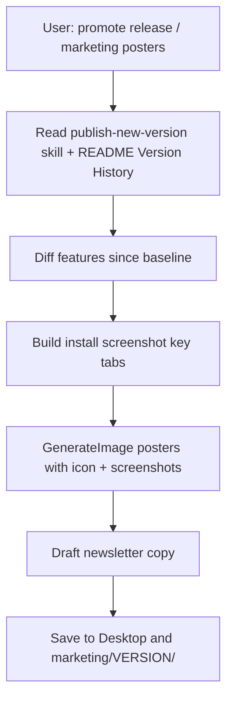

# Promote app release

## Goal

After a version is already published (or while marketing an existing current version), produce a **promotional pack**: real device screenshots, feature highlight board, mockup posters, newsletter banner + copy. Save under **Desktop** and **`marketing/<VERSION>/`**.

**This skill does not bump versions.** Changelog and semver come from `publish-new-version` / README. Do not run a version bump unless the user also asks for `/publish-new-version`.

## Triggers

Apply when the user says any of:

- promote release / promote app release
- marketing posters / promo images
- release newsletter
- App Store promo images
- “make posters for vX.Y.Z”

## Preconditions

1. Confirm **target version** (default: README `### vX.Y.Z (Current)`).
2. Confirm **baseline** for “what’s new” copy (default order):
   - User-stated baseline version, else
   - Previous `marketing/<version>/` folder if present, else
   - Last **3 patch** versions of user-facing notes from Version History
3. For **HAR StockApp** defaults (override only if user says otherwise):
   - Brand name: **HAR StockApp**
   - Icon: `StockMaster/StockMaster/Assets.xcassets/AppIcon.appiconset/1024.png` (dual-H navy/blue)
   - Palette: Harbour Teal + navy — **no purple neon**
   - OTP bypass for screenshots (if needed): email `admin@testing.local`, username `csd.exec`

## Pipeline

Execute in order.

### 1) Read changelog source of truth

1. Skim personal/project **`publish-new-version`** skill so you know where versions live — do **not** bump.
2. Parse `README.md` **`## Version History`** from `(Current)` back to the baseline.
3. Optionally cross-check `git log` for commits matching `Release StockApp v*` / tags since baseline.
4. Build a **user-facing** feature table (no SQL, no branch/internal names). Group into poster themes (design, sales, search, filters, reports, etc.).

### 2) Capture real screenshots

Prefer booted iPhone Simulator. Commands and tab automation notes: [references/sim-screenshots.md](references/sim-screenshots.md).

Minimum set for HAR StockApp:

| File | Screen |
|------|--------|
| `01-search.png` | Search |
| `02-sales.png` | Sales Opportunities |
| `03-stock-age.png` | Stock Age (filters expanded if possible) |
| `04-more.png` / `05-reports.png` | More hub and/or Custom Reports |

Write to `marketing/screenshots/<VERSION>/`.

If UI automation fails, drive as far as possible (AppleScript clicks on Simulator window are OK), document any missing screen in the newsletter footnote, and continue with available shots + icon.

### 3) Generate marketing images

Use **`GenerateImage`** with `reference_image_paths` = app icon + real screenshots. Follow **`imagegen-frontend-mobile`** (phone frames, readable UI) and **`brandkit`** (sparse boards) spirit: Harbour Teal / navy, dual-H icon, readable type.

Deliverables (16:9 unless user asks otherwise):

| Asset | Filename pattern | Spec |
|-------|------------------|------|
| Feature highlight board | `HAR-StockApp-<VER>-feature-board.png` | “What’s New” cards from delta |
| Hero mockup poster | `HAR-StockApp-<VER>-hero-mockup.png` | 1–2 iPhones with real Search / Stock Age |
| Feature mockup strip | `HAR-StockApp-<VER>-feature-strip.png` | 3 phones: Sales, Stock Age, Reports |
| Newsletter banner | `HAR-StockApp-<VER>-newsletter-banner.png` | Brand + headline + CTA “Now on App Store / Update available” |

Copy outputs to:

- `~/Desktop/`
- `marketing/<VERSION>/`

### 4) Newsletter draft

Write `marketing/<VERSION>/NEWSLETTER.md` (and Desktop copy) that:

- Embeds the four filenames
- Summarizes user-facing bullets for Slack/email paste
- Includes a short subject line and CTA

### 5) Completion message

List absolute paths for:

- Screenshots folder
- Four images (Desktop + `marketing/<VERSION>/`)
- Newsletter path
- Any screens that could not be captured

Remind: version was **not** bumped; for the next semver release use **publish-new-version**, then re-run this skill.

## Related skills

- **publish-new-version** — bump + changelog (run before or separately)
- **imagegen-frontend-mobile** — phone mockup framing
- **brandkit** — feature board composition
- **create-skill** — skill authoring rules (when editing this skill)
